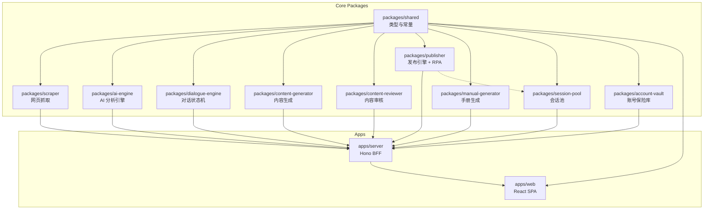

# Brooks-Lint Health Dashboard — 芯图引擎 GEO 系统

**Mode:** Health Dashboard
**Scope:** geo-assistant-clean (entire monorepo: apps/* + packages/*)
**Composite Score:** 70/100

**Trend:** 71 → 70 (−1) over last 2 runs

| 维度 | 得分 | 权重 | 主要发现 |
|------|------|------|---------|
| 架构健康 | 75/100 | 40% | scheduler.ts 职责过载（655行），多类调度器混在一处 |
| 技术债务 | 65/100 | 33% | 认知负载高 + 知识重复（平台映射多处定义） |
| 测试质量 | 70/100 | 27% | 核心包有测试覆盖，但调度器和会话健康模块缺失 |

---

## Module Dependency Graph

---

## Top Findings

### 🔴 Critical

**R1 — Cognitive Overload: scheduler.ts 单文件 655 行，承载 5 类调度逻辑**

- **Symptom:** `apps/server/src/scheduler.ts` 共 655 行，同时包含发布调度器、健康检查调度器、Cookie 保温器、缓存清理器、计划任务调度器共 5 类独立的调度逻辑，各自拥有独立的定时器、状态变量和辅助函数。文件内部有 18 个顶级函数和 6 个模块级可变变量。
- **Source:** Clean Code — Single Responsibility Principle / Deep Modules — Deep Modules
- **Consequence:** 修改某一类调度逻辑时容易意外影响其他调度器；新人理解成本高；调试困难（多个定时器交错运行）；测试难以隔离。
- **Remedy:** 将每个调度器拆分为独立文件（`scheduler/publish-scheduler.ts`、`scheduler/health-checker.ts`、`scheduler/cookie-warmer.ts`、`scheduler/cache-cleanup.ts`、`scheduler/plan-scheduler.ts`），每个文件导出 `startXxx()/stopXxx()` 函数，由 `scheduler/index.ts` 统一编排。

**R3 — Knowledge Duplication: 平台名称映射在多处重复定义**

- **Symptom:** 平台 ID 到显示名称/内部名称的映射散落在 3+ 处：(1) `scheduler.ts` 中的 `PLATFORM_HARVESTER_MAP`；(2) `rpa-engine.ts` 中的 `PLATFORM_ID_TO_SESSION_NAME`；(3) 各 route 文件中也存在零散的平台名硬编码。当新增平台时需要同步修改多处。
- **Source:** The Pragmatic Programmer — DRY Principle / Domain-Driven Design — Ubiquitous Language
- **Consequence:** 新增平台时遗漏某一处映射会导致隐性 Bug；平台命名不一致（weixin vs wechat, baijia vs baijiahao）增加认知负担；重构风险高。
- **Remedy:** 在 `packages/shared` 中建立统一的平台注册表（`platform-registry.ts`），包含 PlatformId → 内部名、显示名、harvester 名、session 名的集中映射。所有包引用此注册表，禁止各自定义映射。

**R1 — Cognitive Overload: RPAEngine 与 Publisher 职责边界模糊**

- **Symptom:** `Publisher` 类既管理平台适配器注册、任务创建、重试逻辑，又持有 RPAEngine 实例并委托 RPA 操作。`RPAEngine` 内部又管理浏览器生命周期、handler 分发、会话池集成。两个类的职责有重叠，且 Publisher.createDefault() 只注册了 WechatAdapter，其余 9 个 RPA handler 散落在 RPAEngine 内部。
- **Source:** Domain-Driven Design — Bounded Context / Clean Architecture — Use Case Boundaries
- **Consequence:** 添加新发布平台时需要同时理解 Publisher 和 RPAEngine 两个类的协作方式；API 发布模式与 RPA 发布模式的切换逻辑分散在多处。
- **Remedy:** 明确划分边界：Publisher 负责发布编排（任务管理、重试、状态流转），RPAEngine 仅负责浏览器 RPA 执行。将所有平台 handler 的注册统一到 Publisher 层，RPAEngine 只暴露 `execute(platform, context)` 接口。

### 🟡 Warning

**R5 — Dependency Disorder: server 层对 packages 的动态 import 破坏静态依赖关系**

- **Symptom:** `index.ts` 中的 `executePlanTask` 函数使用动态 `import('@zemingengine/content-generator')` 和 `import('@zemingengine/content-reviewer')`，虽然意图是懒加载，但 server 的 package.json 中并未声明这两个依赖（可能通过 workspace 隐式获得），导致依赖关系不透明。
- **Source:** Clean Architecture — Dependency Rule / The Pragmatic Programmer — Design by Contract
- **Consequence:** 静态分析工具无法正确识别依赖；打包时可能遗漏依赖；重构时容易打破隐式依赖而不自知。
- **Remedy:** 在 `apps/server/package.json` 中显式声明所有 package 依赖。如果确实需要懒加载，保留动态 import 语法，但依赖必须显式声明。

**T2 — Test Brittleness: 测试缺少集成测试，大量逻辑在 server 层未覆盖**

- **Symptom:** 11 个测试文件主要集中在 packages 层（纯逻辑单元测试），而 `apps/server` 层仅有 db.test.ts、cache.test.ts、routes.test.ts 三个测试文件。调度器、session-health、中间件等核心服务端逻辑完全没有测试覆盖。
- **Source:** xUnit Test Patterns — Test Coverage Gaps / Working Effectively with Legacy Code — Seams
- **Consequence:** server 层重构风险高，修改调度逻辑或健康检查逻辑后无法通过测试快速验证；线上问题可能逃逸。
- **Remedy:** 优先为 scheduler.ts 的纯函数部分（`calculateDynamicCooldown`、`filterDueTasks`、`checkDispatchGuard`、`selectCredentialsForWarming`）补充单元测试；为 session-health 模块的 checker 和 alerter 编写集成测试。

### 🟢 Suggestion

**R4 — Accidental Complexity: 多套定时任务管理模式不统一**

- **Symptom:** 项目中存在至少 6 个独立的 setInterval 调度器，每个都有自己的 start/stop 函数、模块级状态变量、错误处理模式。优雅关闭时需要逐一调用 stop 函数（index.ts 中有 6 个 stop 调用）。
- **Source:** Domain-Driven Design — Aggregate Pattern / Design Patterns — Facade
- **Consequence:** 新增调度器时需要重复编写模板代码；忘记注册 stop 函数会导致资源泄漏；难以统一管理调度优先级和错误策略。
- **Remedy:** 引入统一的 SchedulerRegistry，所有调度器通过它注册，统一管理生命周期（启动、停止、健康检查）。`index.ts` 只需调用 `registry.startAll()` / `registry.stopAll()`。

---

## Summary

芯图引擎 GEO 系统整体架构设计合理，monorepo 分层清晰，核心包（ai-engine、content-generator、content-reviewer、dialogue-engine）的模块边界和测试覆盖都不错。**当前最大的风险集中在 server 层**：`scheduler.ts` 已经膨胀为一个 655 行的上帝文件，承载了 5 类完全独立的调度逻辑，是技术债务增长最快的区域。

**建议优先行动：**
1. **立即拆分 scheduler.ts** — 将 5 个调度器拆分为独立模块，这是收益最高、风险最可控的重构项
2. **统一平台名称映射** — 将散落各处的平台映射收敛到 shared 包，消除知识重复
3. **补充 server 层测试** — 优先覆盖调度器中的纯函数和 session-health 模块

建议下一步运行 **brooks-audit**（完整架构审计）和 **brooks-debt**（技术债务详细评估）获取更深入的分析。
